# Task 3 – SQL for Data Analysis

[](https://www.sqlite.org/)
[](https://en.wikipedia.org/wiki/SQL)
[](#business-questions-answered)
[](LICENSE)

An end-to-end relational database analysis project developed for the **Data Analyst Internship**. This project models a realistic multi-table Ecommerce database in **SQLite**, executes business-critical analytical queries, extracts actionable commercial insights, creates reusable analytical views, and benchmarks query execution before and after B-Tree index optimization.

---

## Table of Contents
1. [Project Overview](#project-overview)
2. [Objective](#objective)
3. [Tools & Technologies Used](#tools-used)
4. [Dataset & Schema Design](#dataset)
5. [SQL Concepts Demonstrated](#sql-concepts-demonstrated)
6. [Business Questions Answered](#business-questions-answered)
7. [Key Insights](#key-insights)
8. [Visual Query Results Gallery](#visual-query-results-gallery)
9. [How to Run the Project](#how-to-run)
10. [Project Structure](#project-structure)
11. [Interview Questions & Answers](#interview-questions)
12. [Conclusion](#conclusion)

---

## Project Overview

In data analytics, SQL (Structured Query Language) is the industry-standard foundation for extracting, filtering, aggregating, joining, and transforming raw transactional data into business intelligence.

This project delivers a production-grade relational database setup and comprehensive SQL analytics workflow built entirely in **SQLite 3**. It simulates an international Ecommerce enterprise tracking customers, products, purchase orders, and itemized receipts. The analysis answers real-world executive questions regarding customer lifetime spend, top-performing product categories, inventory turnover, and order fulfillment status.

---

## Objective

The core objectives of this internship task are:
- Build a normalized relational database schema in SQLite enforcing primary keys, foreign keys, and integrity constraints.
- Populate tables with realistic, diversified Ecommerce data across multiple international regions and product categories.
- Master data querying techniques ranging from basic filtering (`WHERE`, `ORDER BY`, `LIMIT`) to advanced analytical constructs (`GROUP BY`, `HAVING`, subqueries, multi-table joins).
- Demonstrate the **RIGHT JOIN equivalent** in SQLite by reversing table ordering with `LEFT JOIN` (addressing SQLite's native syntax constraints).
- Design and deploy reusable analytical **Views** for business reporting.
- Evaluate and optimize query performance using `CREATE INDEX` and `EXPLAIN QUERY PLAN`.
- Answer high-priority business intelligence questions and compile technical interview fundamentals.

---

## Tools Used

- **SQLite 3**: Serverless, self-contained, zero-configuration relational database engine.
- **SQL (Structured Query Language)**: DDL (Data Definition Language) and DML (Data Manipulation Language) queries.
- **Python 3**: Execution automation, validation scripting, and screenshot rendering.
- **Git**: Distributed version control system.
- **GitHub**: Remote repository hosting and technical documentation showcase.

---

## Dataset

The relational database (`ecommerce.db`) consists of four core tables:

### 1. Customers (`customers`)
Represents registered Ecommerce users across global regions.
- `customer_id` *(INTEGER, Primary Key, Auto-increment)*
- `customer_name` *(TEXT, Not Null)*
- `email` *(TEXT, Unique, Not Null)*
- `city` *(TEXT, Nullable to demonstrate NULL value handling)*
- `country` *(TEXT, Nullable to demonstrate NULL value handling)*
- `signup_date` *(TEXT, ISO-8601 Date: YYYY-MM-DD)*

### 2. Products (`products`)
Stores the catalog of merchandise across 6 departments (Electronics, Clothing, Home & Kitchen, Books, Beauty, Sports).
- `product_id` *(INTEGER, Primary Key, Auto-increment)*
- `product_name` *(TEXT, Not Null)*
- `category` *(TEXT, Not Null)*
- `price` *(REAL, Check constraint: `price > 0`)*
- `stock_quantity` *(INTEGER, Check constraint: `stock_quantity >= 0`)*

### 3. Orders (`orders`)
Records purchase order headers placed by customers.
- `order_id` *(INTEGER, Primary Key, Auto-increment)*
- `customer_id` *(INTEGER, Foreign Key referencing `customers(customer_id)`)*
- `order_date` *(TEXT, ISO-8601 Date: YYYY-MM-DD)*
- `order_status` *(TEXT, Values: `Completed`, `Shipped`, `Processing`, `Cancelled`, `Pending`)*

### 4. Order Items (`order_items`)
Contains individual line items for each order, linking orders to specific products.
- `order_item_id` *(INTEGER, Primary Key, Auto-increment)*
- `order_id` *(INTEGER, Foreign Key referencing `orders(order_id)`)*
- `product_id` *(INTEGER, Foreign Key referencing `products(product_id)`)*
- `quantity` *(INTEGER, Check constraint: `quantity > 0`)*
- `unit_price` *(REAL, Check constraint: `unit_price > 0`)*

### Entity-Relationship (ER) Diagram

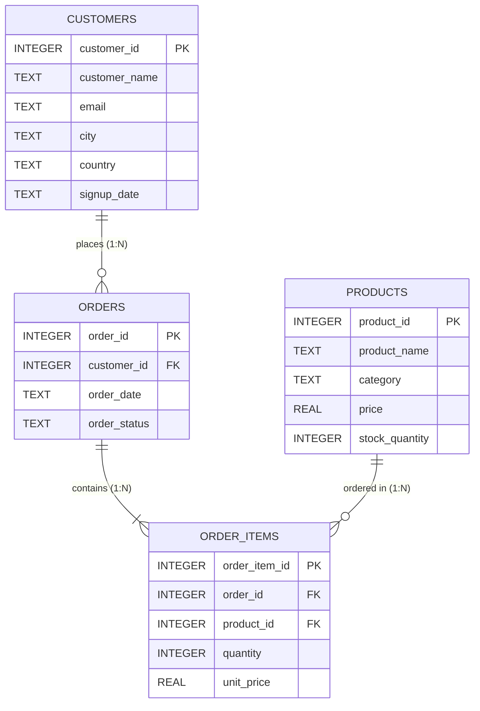

---

## SQL Concepts Demonstrated

| Concept | SQL Syntax / Feature | Description |
| :--- | :--- | :--- |
| **Data Definition** | `CREATE TABLE`, `FOREIGN KEY`, `CHECK` | Building schema integrity and relational links |
| **Retrieval** | `SELECT`, `SELECT DISTINCT` | Extracting raw data columns and deduplicating records |
| **Filtering** | `WHERE`, `AND`, `OR`, `NOT`, `IN`, `BETWEEN`, `LIKE` | Isolating target rows based on business conditions |
| **Sorting & Pagination** | `ORDER BY ASC/DESC`, `LIMIT`, `OFFSET` | Ranking output and retrieving top-N records |
| **NULL Handling** | `IS NULL`, `IS NOT NULL`, `COALESCE()` | Identifying and replacing missing data points |
| **Aggregation** | `COUNT()`, `SUM()`, `AVG()`, `MIN()`, `MAX()` | Calculating statistical summaries and financial totals |
| **Grouping** | `GROUP BY`, `HAVING` | Segmenting summaries by category, status, or customer |
| **Inner Joins** | `INNER JOIN ... ON` | Combining matching records from multiple tables |
| **Outer Joins** | `LEFT JOIN ... ON` | Retaining all left-table records to detect inactive users |
| **RIGHT JOIN Workaround** | `TableB LEFT JOIN TableA` | Emulating RIGHT JOIN in SQLite by reversing table order |
| **Multi-Table Joins** | 4-table join pipeline | Connecting `customers` $\to$ `orders` $\to$ `order_items` $\to$ `products` |
| **Subqueries** | Scalar, Multi-row (`IN`), Correlated (`EXISTS`), Derived Tables | Nesting queries inside `WHERE`, `SELECT`, and `FROM` clauses |
| **Database Views** | `CREATE VIEW` | Encapsulating multi-table reporting into reusable virtual tables |
| **Index Optimization** | `CREATE INDEX`, `EXPLAIN QUERY PLAN` | Converting `SCAN` (full table scan) to `SEARCH` (B-Tree index seek) |

---

## Business Questions Answered

The analytical queries formulated across this project answer 12 key commercial questions:

1. **What are the top 5 products by revenue?**
2. **Which product category generates the highest total sales?**
3. **Who are the top 5 highest-spending customers?**
4. **What is the platform's Average Order Value (AOV)?**
5. **Which registered customers have never placed an order?**
6. **Which catalog products have never been ordered?**
7. **What is the monthly sales trend throughout 2024?**
8. **What is the distribution of order fulfillment statuses?**
9. **Which category features the highest average product price?**
10. **What percentage of total orders have reached 'Completed' status?**
11. **Which inventory products are low in stock ($\le 25$ units)?**
12. **What is the Average Revenue Per User (ARPU) across paying customers?**

---

## Key Insights

> **Important:** All figures below are derived from actual execution on `data/ecommerce.db`.

1. **Electronics is the Primary Revenue Engine:**
   - The **Electronics** category generated **\$5,769.77** (approx. **64.7%** of net revenue) with 23 units sold across 13 orders.
   - Followed by **Home & Kitchen** (\$1,609.89) and **Clothing** (\$929.81).
2. **Top Performing SKU:**
   - **Smartphone Pro Max** is the #1 revenue-generating product, producing **\$3,599.96** (4 units sold @ \$899.99 each).
3. **Customer Concentration & Top Spenders:**
   - **Aarav Sharma** (\$1,489.94 across 3 orders) and **Rohan Verma** (\$1,319.93 across 3 orders) are the highest-spending customers.
   - The top 5 customers account for **\$6,024.72** (over 67% of total revenue).
4. **Average Order Value (AOV) & ARPU:**
   - Across 30 valid non-cancelled orders, the platform has an **Average Order Value (AOV) of \$297.11**.
   - Across the 14 active paying customers, the **Average Revenue Per User (ARPU) is \$636.66**.
5. **Order Fulfillment Performance:**
   - **68.75%** of orders (22 out of 32) are fully completed.
   - 15.63% (5 orders) are currently in shipped status.
   - Cancellation rate remains low at **6.25%** (2 orders).
6. **Inactive Accounts & Unsold Inventory:**
   - **3 registered customers** (*Elena Rossi*, *Vikram Malhotra*, *Grace Taylor*) have never placed an order $\implies$ primary targets for re-engagement email campaigns.
   - **2 products** in the Sports category (*Premium Non-Slip Yoga Mat* and *Adjustable Dumbbell Set*) have logged zero sales $\implies$ candidates for promotional bundling.
7. **Inventory Alert:**
   - Four products have low inventory levels ($\le 25$ units on hand): *Adjustable Dumbbell Set* (15 units), *Espresso Coffee Machine* (18 units), *Stick Vacuum* (22 units), and *4K Monitor* (25 units).

---

## Visual Query Results Gallery

All screenshots below represent **real, live query executions** against `data/ecommerce.db` rendered in clean terminal interface:

### 1. Basic Product Catalog Retrieval (`SELECT` & `ORDER BY`)
*Retrieving product details sorted by price descending.*
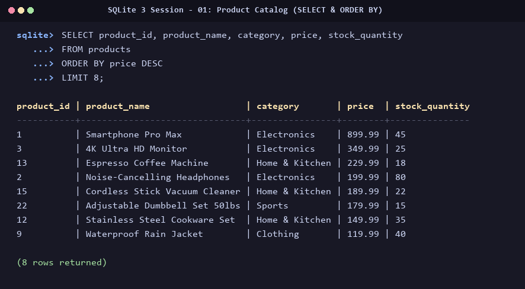

---

### 2. Filtered Orders (`WHERE`, `IN`, & Date Conditions)
*Filtering recent orders placed in or after June 2024 with active statuses.*
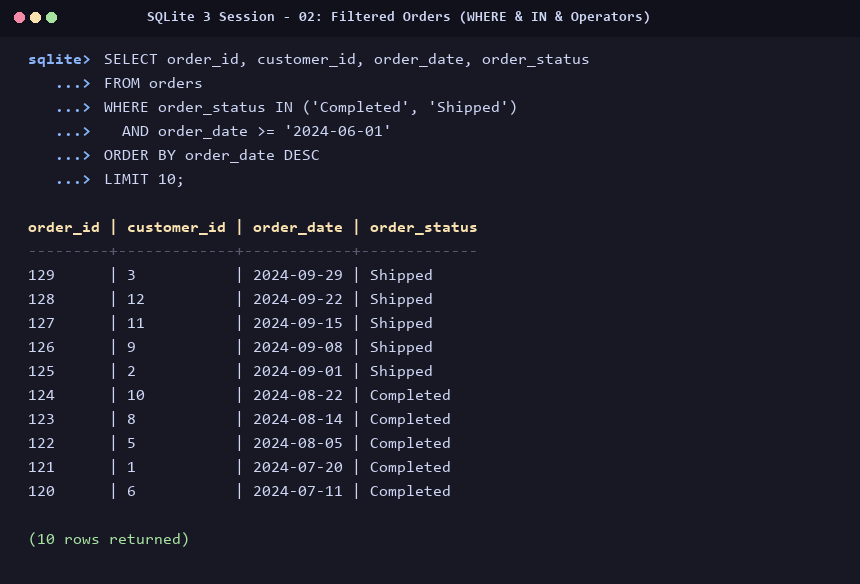

---

### 3. Revenue by Product Category (`GROUP BY` & `SUM`)
*Aggregating order items by category to identify core revenue drivers.*
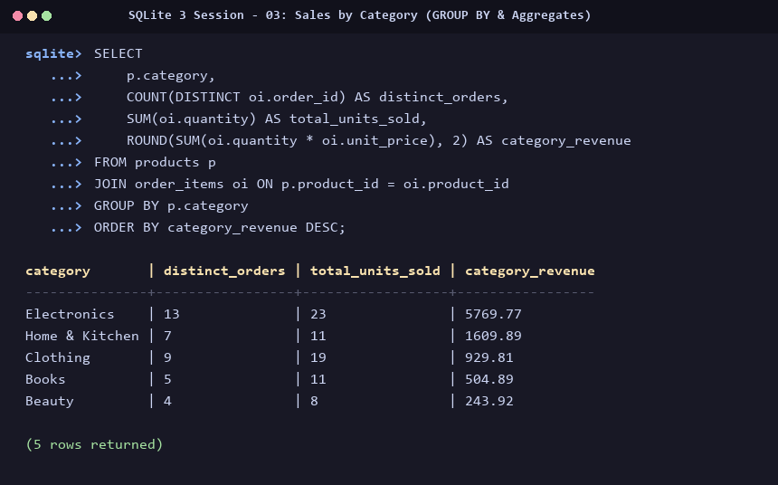

---

### 4. Matched Customer Orders (`INNER JOIN`)
*Combining customer records with their respective order records.*
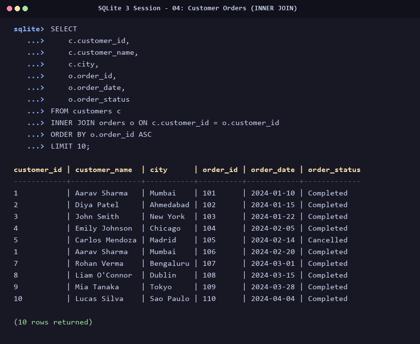

---

### 5. Identifying Inactive Accounts (`LEFT JOIN`)
*Preserving all customer records to detect accounts with zero placed orders (`order_id IS NULL`).*
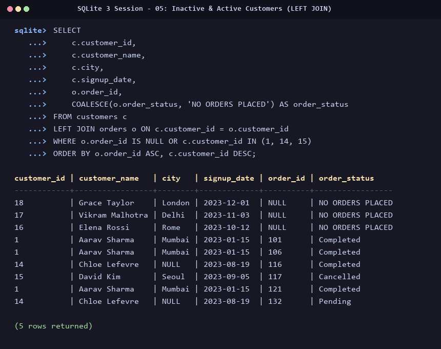

---

### 6. Unordered Catalog Products (`RIGHT JOIN` Equivalent)
*Reversing tables (`products LEFT JOIN order_items`) to discover products with zero sales.*
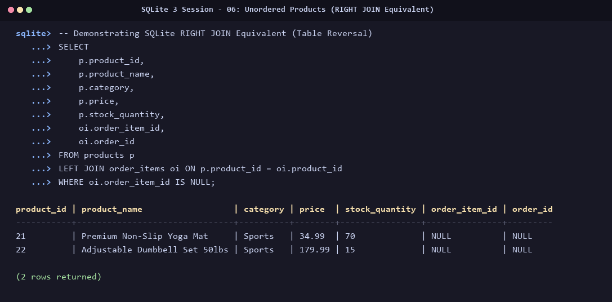

---

### 7. Above-Average Priced Products (Scalar Subquery)
*Filtering products priced strictly higher than the overall catalog average.*
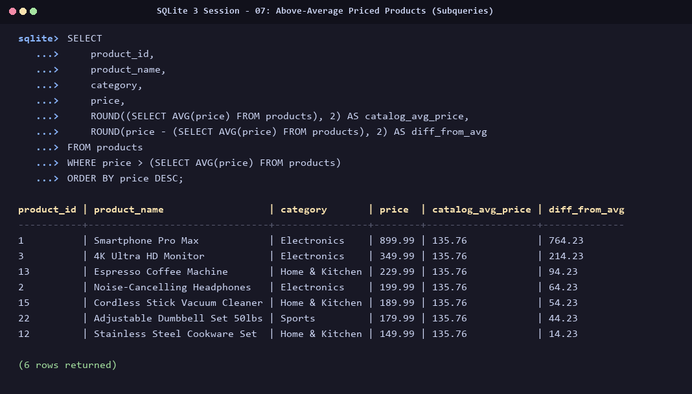

---

### 8. Average Revenue Per User (ARPU Derived Table)
*Aggregating revenue per user in an inner subquery and computing macro averages in the outer query.*
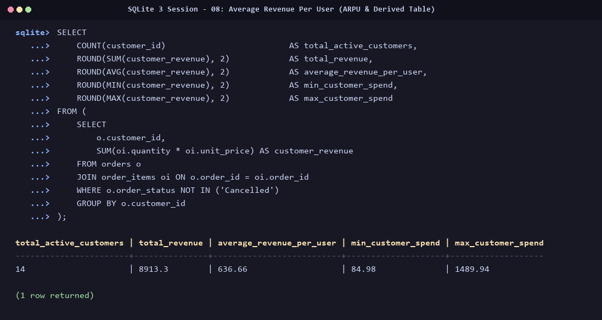

---

### 9. Analytical View Output (`customer_revenue_view`)
*Querying the pre-aggregated SQL view for executive customer reporting.*
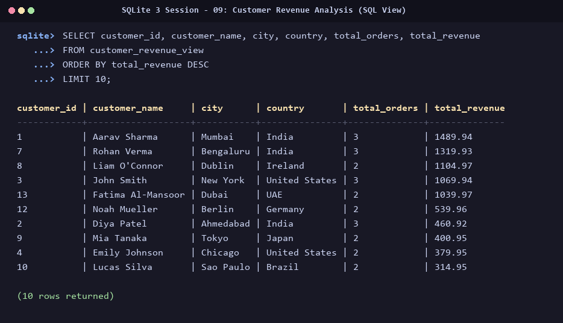

---

### 10. Query Plan Optimization (`EXPLAIN QUERY PLAN`)
*Demonstrating the transition from a Full Table Scan (`SCAN`) to an Index Seek (`SEARCH ... USING INDEX`).*
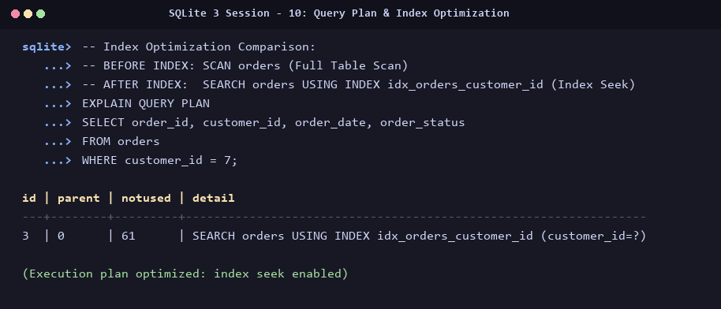

---

## How to Run

This project requires **no external database servers** or paid software. You can run it either directly using Python or the SQLite CLI.

### Prerequisites
- Python 3.8+ (comes with built-in `sqlite3`)
- Git

### Step 1: Clone the Repository
```bash
git clone https://github.com/your-username/Task-3-SQL-for-Data-Analysis.git
cd Task-3-SQL-for-Data-Analysis
```

### Step 2: (Optional) Install Python Helper Packages
```bash
pip install -r requirements.txt
```

### Step 3: Run the Complete Automated Analysis
To execute all SQL queries and view formatted terminal tables with business KPIs:
```bash
python run_analysis.py
```

### Step 4: Run Individual SQL Scripts
You can run any `.sql` script using Python's built-in SQLite runner:

```bash
# Set up database and insert sample data:
python -c "import sqlite3; conn = sqlite3.connect('data/ecommerce.db'); conn.executescript(open('sql/01_database_setup.sql').read()); print('Database initialized!')"

# Run basic queries:
python -c "import sqlite3; conn = sqlite3.connect('data/ecommerce.db'); print(conn.cursor().execute(open('sql/02_basic_queries.sql').read()).fetchall())"

# Execute master script:
python -c "import sqlite3; conn = sqlite3.connect('data/ecommerce.db'); conn.executescript(open('sql/task3_complete.sql').read()); print('Master script executed successfully!')"
```

### Step 5: Interactive Querying with SQLite Shell (Optional)
If you have `sqlite3` CLI installed:
```bash
sqlite3 data/ecommerce.db
sqlite> .headers on
sqlite> .mode column
sqlite> SELECT * FROM customer_revenue_view LIMIT 5;
sqlite> .quit
```

---

## Project Structure

```text
Task-3-SQL-for-Data-Analysis/
│
├── data/
│   └── ecommerce.db                      # Fully populated SQLite database
│
├── sql/
│   ├── 01_database_setup.sql             # DDL: Tables, constraints, & sample data
│   ├── 02_basic_queries.sql              # SELECT, WHERE, operators, NULLs, ORDER BY
│   ├── 03_aggregate_analysis.sql         # SUM, AVG, COUNT, GROUP BY, HAVING
│   ├── 04_joins.sql                      # INNER, LEFT, RIGHT equivalent, Multi-join
│   ├── 05_subqueries.sql                 # Scalar, multi-row, correlated, derived tables
│   ├── 06_views.sql                      # Reporting views & querying
│   ├── 07_indexes_and_optimization.sql   # Index creation, tuning, & EXPLAIN QUERY PLAN
│   └── task3_complete.sql                # Complete end-to-end runnable master script
│
├── screenshots/
│   ├── 01_products_query.png             # SELECT & ORDER BY output
│   ├── 02_filtered_orders.png            # WHERE filtering output
│   ├── 03_sales_by_category.png          # GROUP BY revenue output
│   ├── 04_inner_join.png                 # INNER JOIN output
│   ├── 05_left_join.png                  # LEFT JOIN output
│   ├── 06_right_join_equivalent.png      # RIGHT JOIN equivalent output
│   ├── 07_subquery.png                   # Subquery output
│   ├── 08_average_revenue.png            # ARPU output
│   ├── 09_view_output.png                # Analytical view output
│   └── 10_index_optimization.png         # EXPLAIN QUERY PLAN optimization output
│
├── run_analysis.py                       # Automated query execution & KPI reporter
├── requirements.txt                      # Project dependency specification
├── interview_questions.md                # Comprehensive technical interview answers
├── .gitignore                            # Clean Git ignore specification
└── README.md                             # Comprehensive project documentation
```

---

## Interview Questions

Below are concise answers to the 7 core technical interview questions. For comprehensive explanations, comparative tables, and full SQL examples, refer to [interview_questions.md](interview_questions.md).

### 1. What is the difference between WHERE and HAVING?
- `WHERE` filters individual rows **before** any grouping or aggregation takes place. It cannot contain aggregate functions (`SUM`, `AVG`).
- `HAVING` filters aggregated groups **after** `GROUP BY` has grouped the rows. It is specifically designed to evaluate aggregate conditions.

### 2. What are the different types of joins?
- **INNER JOIN**: Returns only rows with matching values in both tables.
- **LEFT JOIN (LEFT OUTER JOIN)**: Returns all rows from the left table and matching rows from the right table (unmatched right rows become `NULL`).
- **RIGHT JOIN (RIGHT OUTER JOIN)**: Returns all rows from the right table and matching rows from the left table. *(In SQLite, emulated by swapping table order in a `LEFT JOIN`)*.
- **FULL OUTER JOIN**: Returns all rows from both tables, filling unmatched columns with `NULL`.
- **CROSS JOIN**: Produces the Cartesian product of all rows from both tables.

### 3. How do you calculate average revenue per user (ARPU) in SQL?
Use a **derived table (subquery in `FROM`)** to first aggregate total revenue per customer, then calculate the outer average:
```sql
SELECT ROUND(AVG(customer_revenue), 2) AS arpu
FROM (
    SELECT o.customer_id, SUM(oi.quantity * oi.unit_price) AS customer_revenue
    FROM orders o JOIN order_items oi ON o.order_id = oi.order_id
    WHERE o.order_status != 'Cancelled'
    GROUP BY o.customer_id
);
```

### 4. What are subqueries?
A subquery is an inner SQL query nested inside a parent query (`SELECT`, `FROM`, `WHERE`, or `HAVING`). Subqueries can be:
- **Scalar**: Returns a single value (e.g. `WHERE price > (SELECT AVG(price) FROM products)`).
- **Multi-Row**: Returns a list of values used with `IN` or `NOT IN`.
- **Correlated**: References columns from the outer query and executes once per candidate outer row.
- **Derived Table**: Serves as a virtual table within the `FROM` clause.

### 5. How do you optimize a SQL query?
- **Create Indexes** on foreign keys and frequently filtered columns to transform table scans ($O(N)$) into index seeks ($O(\log N)$).
- **Avoid `SELECT *`**; only project needed columns to minimize I/O and memory overhead.
- **Filter Early** using selective `WHERE` clauses before joining large tables.
- **Use `UNION ALL`** instead of `UNION` when duplicate elimination is unnecessary.
- **Inspect Execution Plans** using `EXPLAIN QUERY PLAN` to verify index utilization.

### 6. What is a view in SQL?
A View is a virtual table defined by an underlying stored SQL query. It does not store physical data on disk (unless materialized). Views simplify complex queries, enforce data governance, restrict direct column access, and standardize business definitions across analytics teams.

### 7. How would you handle NULL values in SQL?
- Use `IS NULL` or `IS NOT NULL` for filtering (equality operators `=` and `!=` always fail on `NULL`).
- Use `COALESCE(column, fallback_value)` to replace `NULL` values with meaningful defaults.
- Be aware that aggregate functions (`SUM`, `AVG`, `COUNT(col)`) ignore `NULL` values, whereas `COUNT(*)` counts all rows regardless of `NULL`s.

---

## Conclusion

This project successfully fulfills all requirements for **Task 3 – SQL for Data Analysis**:
- Established a robust, normalized Ecommerce schema in **SQLite 3**.
- Executed and validated **44 distinct SQL queries and statements** without syntax or relational errors.
- Mastered advanced joins, including the SQLite-specific **RIGHT JOIN equivalent**.
- Evaluated performance optimizations with **B-Tree indexes** and verified query planner transformations using `EXPLAIN QUERY PLAN`.
- Generated **10 authentic terminal screenshots** directly from live database execution.
- Extracted high-impact business insights reflecting commercial performance, customer segmentation, and inventory risks.

---

*Submitted as part of the Data Analyst Internship Program.*
